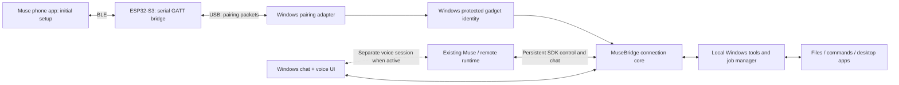

# MuseBridge MasterPlan

> **Current dispatch (2026-11-13): [HARNESS-UPGRADE-PLAN.md](HARNESS-UPGRADE-PLAN.md), MB-24 to MB-36.** MB-24 through MB-31b are complete. Current build: 0.7.0, contract 2, catalog schema 4; see [finish-line evidence](evidence/MB-31b-finish-line.md) for the latest local suite. The frozen v2-context evaluation passed 12/12 versus baseline 9/12, using 139 calls versus 206 and 6,543 versus 35,429 preamble bytes across fourteen sends. Owner confirmed the VM skill; P-5 selected first-message-only headers. Main uses PC-Workspace and can execute PC commands, while shared-Main completion remains unattributed; use dedicated project chats for automatic continuation. Desktop/Start-menu launchers are installed. Next work: MB-31c stall hints, then MB-32 shell-change recovery. See [context evidence](evidence/MB-30-context.md), [edit-feedback evidence](evidence/MB-31a-edit-feedback.md), [remaining-work assessment](docs/REMAINING-WORK-2026-11-13.md), and [running guide](RUNNING.md). The upgrade plan is the current backlog. Owner rules here still apply and are restated there; the sections below retain the MB-01 to MB-23 architecture/history.

Historical 0.6.0 record, updated 2026-11-11. **MuseBridge 0.6.0 adds the five requested capabilities to the local harness. 225 local tests pass (4 skipped); actual Muse PDF/DOCX reading, two automatic image continuations with browser interaction, and before/after hooks passed. Speech and real desktop acceptance remain pending.** Start with the [current five-capability evidence](evidence/FIVE-CAPABILITIES-0.6.md) and [running guide](RUNNING.md). Remaining work is maintained in HARNESS-UPGRADE-PLAN.md. The [earlier baseline receipt](evidence/HARNESS-2026-11-11.md), [implementation receipt](evidence/MB-01-02.md) and [research](RESEARCH-2026-11-11.md) retain their dated scope. [Earlier game plan](PC-HARNESS-GAMEPLAN.md) and [inventory](INVENTORY.md) are historical.

## Goal and owner requirements

**Visual/QoL update:** the owner authorized this phase using a DeepSeek Harness screenshot as the visual basis. Version 0.3.0 implements the workspace shell, Chat/Activity/Plan views, rounded composer and everyday navigation/persistence improvements. The live app was restarted and its Connected status verified. See [visual receipt](evidence/VISUAL-2026-11-11.md) and [shared UI rules](docs/UI-DESIGN.md). Functional speech/desktop acceptance remains open.

**Harness expansion plan:** the owner agreed to the capability recommendations and requested one implementation-and-testing plan covering them all. The historical expansion program is [the section below](#harness-expansion-program--mb-11-through-mb-23), MB-11 through MB-23. Version 0.5.0 implements the local expansion described below; the acceptance ledger distinguishes exercised features from pending speech/desktop/device and service limits. Muse already has skills/workflows on its VM; the PC supplies execution adapters and evidence, not a competing skills runtime.

Give the owner a Windows chat and voice companion for his existing Muse, with responsive tools that execute directly on his PC.

the owner's clarification during this review: he has no home automation devices currently and wants to focus on the harness. He prefers typing to Muse in a desktop conversation like this Codex chat, or activating voice and asking Muse to work on the PC, without messaging from a phone and then traversing a VPN tunnel and SSH. Therefore a dedicated chat interface is part of the first usable product, not an optional finishing touch. Home automation is deferred.

Owner expanded scope to a typical harness with separate conversations, projects, goal/planning and persistent work state; functional behavior precedes QoL/visuals. Development delegation uses up to two a helper model workers as explicitly requested; these are development helpers, not runtime dependencies. Earlier owner correction remains applicable: no second local agent/model doing the work on Muse's behalf. Muse remains the remote reasoning agent; local software provides its connection, UI and tools. the implementation agent is the implementation agent for this project, not a runtime dependency.

the owner authorized implementation on 2026-11-11: “Lets get this going. I want you to do the work, let me know when and how to plug the esp board in for you flash or whatever needs done.” This lifts the planning-only hold and authorizes project development and planned board flashing/setup. Phone interaction and entering the SDK token remain physical/account steps for the owner. Do not repeatedly ask for build/flash authorization. Startup at login is not enabled; preserve OpenClawGateway. Previous operating rules call for silent operation, checking user activity before desktop control, and explicit authorization for persistent connections. Read the current user instruction before applying historical rules.

## Finished experience

the owner opens MuseBridge, sees which Muse/chat it is connected to, types a request, and sees the reply and actual tool activity in the same window. Muse can inspect a selected project, edit files, run tests, and interact with ordinary Windows applications when needed. A voice control starts and ends a call using the PC microphone/speakers; typing remains available. Pause/disconnect and Stop Work have distinct visible behavior.

The ESP32 is used during Bluetooth provisioning. The steady-state PC connection uses the PC's own network. No SSH, VPN tunnel, WSL, scheduled-task polling or second model belongs in this runtime path. Internet and Muse's service are still required. Response time includes Muse's reasoning and cannot be promised to be instantaneous.

## Architecture selected for the proposed build

This is the recommended technical design, not a claim of owner acceptance or completed hardware validation.

The diagram separates provisioning from normal operation. USB does not carry everyday chat or screenshots in this design. The board is a custom BLE peripheral transport, not a generic Windows Bluetooth adapter. After provisioning, disconnecting the board should not stop PC chat/control; that must be demonstrated. Re-pairing needs it again. The phone is expected for initial setup, not daily use.

### D1 — Native Windows companion; reuse Muse's protocol implementation

Port the required portions of the official Python Linux SDK into a Windows-compatible adapter layer, preserving its pairing crypto and Noise/Link protocol. Keep upstream code pinned and changes small enough to review and update. Do not implement new cryptography, emulate Muse by prompting a different model, or scrape the Muse website.

**Starting stack:** Python for the SDK adapter and executor; PySide6 for a small native chat window; an asyncio worker separate from the GUI thread; SQLite for the local job journal. Use an isolated environment and select/pin an interpreter supported by these dependencies during MB-01. Existing Python 3.14.6 is historical inventory, not proof that the complete dependency set works. Sol can adjust a package/version for demonstrated compatibility without reopening the product architecture.

Reuse Windows UI Automation through a focused adapter. Add a small native helper only if the selected library cannot provide required process/session behavior. Avoid starting with a whole browser/Electron product or a full DSH fork. Qt licensing and packaging notices belong in any distributable build, not an assumed license inherited from the Muse SDK.

Known port work: Linux executor imports `pwd`, invokes `/bin/bash`, uses Unix account/group and process-group semantics, and reads `/proc`. The service uses Unix sockets and Unix signal handlers. Replace those boundaries; importing the existing Linux service unchanged is not a Windows port. Prefer in-process calls between UI and connection core initially, eliminating any need for a local listening server.

### D2 — ESP32 supplies BLE transport for pairing only

Use the S3 as a GATT server that forwards pairing packets over a framed USB serial protocol. The Windows process owns the gadget identity and pairing state, uses the SDK's SetupController/PairingSession, and persists credentials after server verification. The firmware handles advertisement, characteristics, negotiated MTU, ordered notifications, connect/disconnect events and transport flow control. Do not copy an already paired board's credentials or create duplicate live identities.

The Linux source provides a real transport seam, but this exact arrangement remains experimental. Define and test serial framing, bounds, backpressure, timeouts, reset/reconnect and generation IDs. A phone disconnect must reset the host pairing session. A stale serial response must never complete a newer pairing attempt. Feed ATT packets into the existing SDK framing layer exactly once; distinguish ATT MTU from payload capacity. Logs must never contain provisioning tokens or encrypted-session secrets.

Do not configure the same board as both a stock paired gadget and the PC's pairing bridge without a designed mode switch. Initial bridge firmware need not use Wi-Fi. Later home-device duties require another firmware design or a separate board; they are not included in v1.

### D3 — One remote agent; local tools run in the owner's interactive session

The app runs as the owner, normally without elevation, while deliberately open/connected. File and process tools work without keyboard/mouse simulation. Desktop tools use UIA first and screenshots/input only when needed. No Session 0 executor and no scheduled-task launch per command. Startup at login is a later explicit operating preference, not a prerequisite.

Prefer application APIs, filesystem operations and commands over clicking. For GUI actions, check the active Windows session, lock state, foreground target and user activity. If the owner is using the desktop, surface a focused handoff rather than stealing input. Elevated apps, UAC and the secure desktop are out of the normal desktop-control contract. A background shell can still operate while a GUI is unavailable, subject to the selected work scope.

### D4 — Existing Muse chat, plus a separate voice channel

Adapt the SDK's send/subscribe behavior into the window. Initially select the existing main Muse chat explicitly and show its identity; add side-chat selection once validated. A successful send acknowledgment is not a completed answer. Reconcile acknowledged message IDs, streaming edits/final corrections and phone/web echoes without duplicating user messages. Preserve ordering and follow-up messages while Muse is working. Never blindly resend an unacknowledged message after reconnect: it may already have been submitted.

Voice uses the SDK's existing voice session/capture code as the starting point. It is a separate transport from the gadget control session, so starting a call must not replace the connection that receives PC tool commands. Explicitly route the voice thread to the selected chat and verify that spoken requests can invoke the same PC tools. Server admission, microphone behavior, echo management, interruption and hangup all need live proof. Use PC audio hardware, not this bare ESP32 board. Push-to-talk/headphones are a sensible first tested mode; open-mic conversation follows if its behavior is acceptable.

### D5 — DSH is a possible later UI/plugin host, not the starting dependency

DSH can replace its agent loop and UI components through plugins. Therefore a custom remote-Muse integration could be built inside it without a local LLM loop. However, an ordinary model-provider plugin is the wrong abstraction: Muse's existing remote conversation and tools are not simply a chat-completions endpoint. Adapting DSH sessions, streaming, tool displays and cancellation could exceed the work saved by its UI.

Current implementation reuses Playwright, pywinauto and the official SDK while following DSH patterns for tools/events/persistence. No DSH runtime or fork was added. Use a small standalone client first. If a DSH integration is later justified, expose the same MuseBridge core through a plugin and disable its local model/agent loop for this mode. Keep any experiment isolated from the owner's installed DSH profiles and credentials. Do not fork the entire product merely to get a chat window.

## What is feasible with the current hardware

| Requirement | Assessment |
|---|---|
| PC chat to the existing Muse | SDK has the relevant operations; Windows adaptation and this account's live behavior are unverified. |
| Muse edits/runs/tests locally | Feasible with a Windows executor and advertised commands; no additional AI model is needed. |
| Lower transport overhead | A direct persistent connection removes the previous per-action SSH/task/file relay. Measure the resulting improvement; do not promise instant reasoning. |
| Voice in the PC window | Plausible using existing SDK voice code and working PC audio devices; requires separate integration and live validation. |
| Pair without purchasing a Bluetooth adapter | The pictured S3 has the needed BLE hardware. Custom bridge firmware and host transport are the principal experiment. |
| Arbitrary Windows app control | Partial: normal interactive apps are practical; secure desktops, elevation, inaccessible/custom UIs and simultaneous user input are meaningful limits. |
| Offline Muse or a locally hosted Muse model | Not provided by this design. |
| Future home-device control | Deferred. S3 supports BLE and 2.4 GHz Wi-Fi, not every radio/protocol. No device purchases are needed for the harness prototype. |

The module marking is consistent with 16 MB flash / 8 MB PSRAM. It is more than adequate for the proposed serial BLE bridge. The board's exact flash, USB ports and pin mapping still require physical checks. A data cable, phone with Muse and account/SDK access are prerequisites; usable PC audio devices are needed for voice. No hardware purchase is recommended before the pairing experiment.

## Current development position

| Area | State | Evidence / gap |
|---|---|---|
| Product requirements | Clarified in this conversation | Dedicated PC chat/voice; harness first; home automation deferred. |
| Technical source review | Completed for planning | [Research](RESEARCH-2026-11-11.md), pinned Muse revision. |
| Local application / firmware | Functional development baseline | [Current evidence](evidence/HARNESS-2026-11-11.md), [running guide](RUNNING.md). |
| Pairing / account connectivity | Owner reports setup works | [Physical receipt and owner follow-up](evidence/MB-02-physical.md); health invocation, token rotation and board-unplug checks not independently captured. |
| Hardware / Windows acceptance | Board identified/backed up/flashed; native UI running | Physical receipt records flash/USB verification. Real UIA task and spoken task remain pending. |
| Performance / reliability | Unmeasured | Historical timings are a comparison baseline only. |

## Execution contract to keep stable across transports

These are proposed MuseBridge interfaces, not existing SDK command names. Implement a small versioned schema before broadening capabilities.

| Interface | Purpose |
|---|---|
| `bridge.capabilities` / `bridge.health` | Version, available tools, selected work scope, session/lock state and connection status; no credentials. |
| `job.start` | Admit an operation with caller request ID, operation kind, validated arguments, deadline and work scope; return a job ID promptly. |
| `job.status` / `job.wait` | Retrieve state and bounded output since a cursor; wait is bounded and releases promptly on completion/cancellation. |
| `job.cancel` | Cancel that job's owned process tree and report the actual terminal state. |
| `file.read` / `file.write` | Bounded reads and staged, atomic replacement for writes; verify length/hash and reject stale write expectations. |
| `desktop.observe` / `desktop.act` | Capture a scoped observation; apply a bounded action against a validated target, then verify the result. |

Advertise exact tool descriptions using the SDK's command registration. Test that Muse discovers and calls them from both typed and spoken requests. Large outputs become paged artifacts; the ESP32 is not an artifact transport. Reuse upstream commands where their semantics match, but never silently reinterpret Linux shell commands as Windows commands. Declare the supported shell and Windows path semantics.

Job journal: `accepted`, `running`, `succeeded`, `failed`, `cancelled`, `interrupted` or `outcome_unknown`. Persist admission before launching a side effect. Duplicate request IDs return the existing job rather than rerun it. This prevents ordinary replay; it does not guarantee exactly-once behavior across every crash. Reconcile incomplete jobs at startup and never automatically repeat an operation with uncertain outcome. Test cancellation of grandchildren, not just the shell process.

Disconnect stops new remote admission but is not automatically cancellation of existing jobs. Stop Work cancels owned jobs and pauses admission. App exit must explicitly stop/reconcile its jobs; it must not silently orphan them. A local cancellation cannot promise that Muse has stopped reasoning remotely. Keep the UI truthful about each state.

Credentials live under an application-owned user data directory, protected with Windows user-bound storage/ACLs; never in the repository, chat transcripts or telemetry. Preserve upstream token-refresh behavior and persist rotations atomically. Only one active PC instance owns a given gadget identity. No public listener or router port forwarding is required for the target architecture.

Work scopes and file allowlists help prevent mistakes. Arbitrary shell commands running as the owner still have the owner's permissions; a chosen working directory is not an OS sandbox. Begin with harmless fixed probe tools, then add development commands within the build's authorized scope. Do not describe the result as sandboxed unless a real isolation boundary is implemented and tested.

## Existing milestones and acceptance

The functional baseline is implemented. Live PC work, separate remote chat, bounded goal progression and voice admission/hangup are verified; speech, actual UIA actuation and daily-use acceptance remain. The owner has now requested visual/QoL work; its first pass is implemented alongside the remaining functional acceptance work. Update this table and its evidence links in the same change as each implementation milestone.

| ID | State / dependencies | First concrete action | Complete when / evidence destination |
|---|---|---|---|
| **MB-01: Windows portability and app skeleton** | Locally verified | Retain isolated Windows environment and pinned SDK. | Native GUI/runtime without WSL/BlueZ; [baseline receipt](evidence/MB-01-02.md). |
| **MB-02: Serial BLE pairing** | Physically verified; owner paired | Use saved pairing; do not reflash/re-pair unnecessarily. | Chip/backup/flash/USB verified and live account connection works; [receipt](evidence/MB-02-physical.md). |
| **MB-03: Dedicated live chat** | Live main and separate side chat verified | Continue targeted reconnect/token/board-unplug checks. | Acknowledgment/cancellation fixes and live chat/tool routing; [current evidence](evidence/HARNESS-2026-11-11.md). |
| **MB-04: Useful development tools** | Implemented, locally and live-Muse verified | Try an owner-selected disposable project, then ordinary work. | Real Muse edited a file, ran PowerShell verification and inspected exit0; cancellation/dedup/output tests pass. [Evidence](evidence/HARNESS-2026-11-11.md). |
| **MB-05: Voice with tool use** | Implemented; silent live admission/hangup verified | Owner starts voice in a dedicated conversation and asks for a benign project task. | Real speech/audio/mute/interruption and spoken-tool acceptance remain; [evidence](evidence/HARNESS-2026-11-11.md). |
| **MB-06: Desktop observation and action** | Implemented; mocked guards verified | Perform/verify a benign task in an owned disposable window while user idle. | Actual UIA controls, focus and edit behavior accepted; [adapter evidence](evidence/desktop-development.md). |
| **MB-07: Daily-use acceptance** | Functional controls implemented; acceptance pending | Exercise sleep/wake, long connection, rotation and cancellation on ordinary workflows. | Owner accepts functional reliability; package/visual/QoL work follows. [Current evidence](evidence/HARNESS-2026-11-11.md). |
| **MB-08: Projects, conversations, plans and goals** | Implemented; persisted locally and live two-turn goal verified | Use New project/New conversation and Plan / goal; Continue goal is explicit and bounded. | Separate remote IDs, context, drafts/history and terminal-event continuation; [evidence](evidence/HARNESS-2026-11-11.md). |
| **MB-09: Browser tools** | Implemented; actual Chromium/local HTTP tests passed | Use browser tools within a selected conversation; verify effects. | Isolated contexts, navigate/observe/fill/click/artifacts; [adapter evidence](evidence/browser-development.md). |
| **MB-10: Visual shell and daily QoL** | First pass implemented; 78 tests pass and live app connected | Owner reviews the new shell in ordinary use; refine concrete friction and packaging next. | Reference-inspired layout; searchable workspaces/chats; rename/archive; Markdown; protected drafts/plans; saved layout; shortcuts; activity/jobs. [Evidence](evidence/VISUAL-2026-11-11.md), [design rules](docs/UI-DESIGN.md). |

Retain these baseline milestone receipts and carry their remaining acceptance into MB-23. The paired app and real text/tool round trip already work; no fresh pairing or build approval is required to begin the expansion program. Mock tests remain separate from physical/live proof.

## Harness expansion program — MB-11 through MB-23

### Outcome, baseline and ownership

**Current authorized work — 0.6 five-capability follow-up:** the owner selected automatic visual feedback, PDF/Word text reading, broader hooks/plugins, a VT terminal screen and silent desktop notifications. Implement these under MB-15/18/20/17 with integrated tests under MB-23; the 0.5 receipt below remains the verified baseline. Use explicit same-chat image continuations through the supported SDK route, bounded isolated document parsing, owner-configured hooks, owned terminals and opt-in notifications. Do not add another model, re-pair, change startup settings or invent native Muse fork/steer APIs. All five are implemented and exercised; see [current evidence](evidence/FIVE-CAPABILITIES-0.6.md) for the exact scope, 225 passing tests, real Muse loop and native component checks.

**Execution update (2026-11-11):** 0.5.0 adds continuity and summary-seeded chats, explicit queues, local hooks, Git review/worktrees, ConPTY terminals, stdio MCP, artifact/document snapshots and a global work overview to the tested 0.4 foundation. Existing Muse VM skills stay remote. Read the [integrated acceptance ledger](evidence/MB-23-integration.md), [workflow contract](docs/WINDOWS-WORKFLOW-CONTRACT.md) and feature receipts before continuing. Speech, real desktop tasks, extended recovery and unsupported remote APIs remain open; this is a functional development build, not full owner acceptance.

the owner asks Muse to carry out a project workflow from this Windows chat or voice session. Muse uses its existing VM skills to select the procedure, obtains the current Windows capabilities/context, performs tracked work, sees actual files/screenshots/results, checks the acceptance criteria and reports completion or the precise remaining obstacle. the owner can inspect changes, correct direction, recover tracked edits and resume a project in a fresh conversation. One integrated development campaign covers implementation, UI, migration, failure handling and live acceptance; do not stop at adapters with no usable UI or at a green mocked suite.

Baseline is 0.3.0, with the 2026-11-11 receipt of **78 passing tests and one symlink-capability skip**. Existing files/jobs, browser, UIA, side chats, plans, bounded goals, draft/layout persistence and Markdown UI are implemented. No new baseline suite was run for this planning-only update. Current owning seams inspected: `musebridge/core.py` (context/send/subscribe), `tooling.py` (command contracts/routing), `catalog.py` (persistent records), `workspace.py` (checked atomic edits), `jobs.py` (Windows Job Objects), `goals.py` (acknowledged turn progression), `browser.py`, `desktop.py`, `shell.py` and `shell_actions.py`. The SDK remains pinned and unchanged. The root has no Git metadata; preserve existing work and do not assume worktree commands apply to MuseBridge itself.

Ownership is explicit:

| Responsibility | Owner / integration decision |
|---|---|
| Existing skill discovery, procedure selection and general reasoning | Muse's VM. Owner reports these already exist; VM contents were not inspected during this planning pass. Reuse a representative existing workflow for the live test. |
| Windows tools and capability discovery | MuseBridge. Advertise exact tool names, OS/shell, scopes, limits, enabled profile and evidence formats. Give the VM enough information to choose the Windows route without SSH or a VPN tunnel. |
| A VM skill containing Linux commands or VM-local paths | Adapt that workflow's execution boundary to the Windows tools. Instructions can stay on the VM; Bash commands cannot simply become PowerShell commands, and a VM path cannot identify a PC file. |
| Project guidance, task ledger, tracked changes and handoff record | Stored locally and exposed to Muse with explicit project/conversation identifiers. These complement the remote skill/memory system. |
| Local scripts, lifecycle hooks and external tool processes | Deterministic Windows execution with bounded lifecycle and declared effects. No extra local model or second agent loop. |
| Remote hidden context, compaction, token accounting and native worker spawning | Muse service. Treat as capability questions; do not manufacture local UI controls that imply unsupported service behavior. |

**Correction to the earlier recommendation:** MB-11 is compatibility/discovery for existing skills, not a new local skills marketplace or a copy of the VM's skills folder. Only introduce optional local workflow metadata when a concrete Windows requirement needs it; avoid two independently edited versions of a procedure. Supporting files may be transferred or read deliberately, with source/version shown; do not automatically mirror private VM data. There is no need for board changes for this program.

### Decisions to keep stable

- Build on the native Qt/core separation. Borrow DSH's modular services/events, Claude's tracked-edit recovery and workflow hooks, and Codex's review/worktree/queue patterns; no full harness fork or provider swap is planned.
- Extend the existing catalog with versioned, transactional migrations and stable IDs for turns/runs, tasks, edits, artifacts, queue entries and verifications. Each effect/result links to its project and conversation; add an explicit run ID rather than infer ownership from whichever chat is selected when a callback arrives.
- Use typed capability discovery and a common admission/event boundary for files, jobs, desktop/browser, hooks, terminal sessions and MCP. UI actions and remote tool calls must enforce the same rules. Keep sensitive arguments/output out of routine diagnostics.
- Model acceptance, execution and verification separately: `accepted` is not `succeeded`, and a succeeded command is not automatically a verified goal. Store the observed verifier result and revision/hash it checked. Remote assertions alone cannot create a local verification receipt.
- Reuse existing cancellation, request deduplication and unknown-outcome semantics. No automatic replay of an ambiguous send, mutating hook, command, terminal input or external tool action after a lost response or restart.
- Keep project-wide permissions convenient: explicit Read only, Project work and Desktop control profiles, with visible scope and reusable configuration for a trusted project. Do not add a confirmation prompt to every ordinary tool call. Real limits must be enforced at dispatch; profiles are application policy, not an OS sandbox. Arbitrary shell code retains Windows-user permissions.
- Read only permits inspection tools and internal journal/artifact storage but no workspace writes, arbitrary shell/PTY, desktop actuation or unclassified mutating extensions. Do not attempt to prove arbitrary PowerShell read-only using string matching. Project work preserves the current useful file/job workflow; Desktop control is explicit and respects idle/foreground/session guards.
- Keep local recovery distinct from remote history. Restoring files cannot undo email, network actions, installs, external devices or arbitrary command side effects. A new chat seeded with a handoff is not a native fork of Muse's hidden state.
- Maintain the current visual language. Changes, task progress, attachments, queue state and blocked/input-required states need real UI destinations, accessible labels, keyboard operation and meaningful empty/error states.

### Complete work inventory

The expansion started as planned/unimplemented; the dated states below now distinguish delivered work from pending scope. Each ID owns its implementation and test criteria here; execution receipts belong under `evidence/` and must link back to the ID. Update status, next action and receipt in this section in the same change as implementation.

| ID | Deliverable / first action | Dependencies | Completion and evidence |
|---|---|---|---|
| **MB-11: VM workflow compatibility and capability contract** | **Implemented and live-tested (2026-11-11).** Extract a versioned Windows capability manifest from existing specs/health/context. Define VM-vs-PC path, shell, scope and result semantics; use one existing Muse workflow rather than install a duplicate skill library. | Baseline core/router. Start first. | Muse discovers the selected Windows project/tools, follows its existing workflow and completes a disposable PC task without SSH or a local model. Contract fixtures cover unavailable tools, changed versions and stale scope. Receipt: `evidence/MB-11-workflow-contract.md`. |
| **MB-12: Shared run events and execution profiles** | **Implemented initial foundation; local and live-tested (2026-11-11).** Add durable run/turn IDs, ordered admission/start/result/verification events and a single policy boundary. Bind requests to conversation/project/profile and implement Read only, Project work and Desktop control. | MB-11. Foundation for all new executors. | Cross-chat/workspace requests and revoked/stale admissions cannot mutate the wrong target. Read-only and Stop Work cover every adapter, including later hooks/MCP/PTY. Compatible migrations preserve existing records. Receipt: `evidence/MB-12-runs-policy.md`. |
| **MB-13: Changes, checkpoints and restore** | **Implemented for direct file tools; local/UI tests and live checkpoints passed (2026-11-11).** Capture before/after content and hashes around existing file tools; add per-run Changes UI, diffs and explicit restore. Track creates/deletes supported by the implementation. | MB-12; integrate MB-19 for shell changes. | Inspect a change, restore tracked edits and retain later owner edits by refusing conflicts. Interrupted writes/restores recover honestly. Clearly label direct-tool coverage versus shell/external effects; never claim arbitrary commands are reversible. Receipt: `evidence/MB-13-changes.md`. |
| **MB-14: Structured tasks and verification** | **Implemented; actual Muse task/check and stale-input acceptance passed (2026-11-11).** Add task IDs, dependencies, criteria, state transitions and verification receipts alongside the current plan. Render task progress and distinguish planning-only work from execution. Integrate with GoalRunner. | MB-11/12; use MB-13 revisions where available. | A multi-step task progresses only through valid dependencies; completion shows relevant checks against current outputs. A failing or stale verifier prevents locally verified status. Unverifiable criteria remain explicitly awaiting review. Retain bounded continuation, pause and no startup autorun. Receipt: `evidence/MB-14-tasks.md`. |
| **MB-15: Attachments, vision and artifacts** | **0.6 implemented and live-tested.** PDF/DOCX text extraction with bounded workers/cache, plus owner-enabled automatic same-chat screenshot continuations. Actual document markers and two screenshot codes verified after a browser click. Selected-window capture renders only its granted HWND/process with no screen-grab fallback. No OCR/old .doc/universal window capture. See [0.6 evidence](evidence/FIVE-CAPABILITIES-0.6.md). | MB-12; MB-11 capability reporting. | Real Muse correctly reports the contents of a synthetic test image and can receive an explicitly selected screenshot of an owned test window. Text/context is preserved with the image; invalid/oversized images and ambiguous sends do not lose drafts or resend. Generated artifacts have usable previews/open actions. Receipt: `evidence/MB-15-artifacts.md`. |
| **MB-16: Project continuity and handoffs** | **Implemented and live-tested.** Source-linked notes/corrections, bounded effective task/check/change summaries and deliberate paused new-chat handoff; real new chat received the exact seed marker. Canonical UUID and post-ACK tracking regressions fixed. See [receipt](evidence/MB-16-continuity.md). | MB-12/14; MB-13/15 references as available. | A fresh conversation resumes the right project and pending work without copying unrelated chat/private data. Notes show provenance and can be corrected/superseded. Keep project facts separate from untrusted document instructions. No competing global Muse memory system or fake token/compaction meter. Receipt: `evidence/MB-16-continuity.md`. |
| **MB-17: Queue, background progress and attention** | **Implemented and exercised.** Existing durable queue/dashboard plus 0.6 opt-in silent Windows notifications, generic text, click routing, dedup/rate limit and icon cleanup. Native Shell acceptance passed; OS may suppress display. No native steering implied. See [0.6 evidence](evidence/FIVE-CAPABILITIES-0.6.md). | MB-12/14; MB-22 steering result. | Queue order, per-chat isolation, cancellation, duplicate submits and restart/unknown-send recovery are deterministic. Startup presents pending entries for deliberate resumption; never silently submits them. Background local jobs remain visible across chat switches, without silently expanding remote goal concurrency. Notifications do not steal focus or play sounds by default. Receipt: `evidence/MB-17-queue.md`. |
| **MB-18: Lifecycle hooks and extension boundary** | **0.6 implemented and live-tested.** Before/after work-tool hooks with exact filters, bounded supervised precheck gate, versioned event context, and reviewed JSON plugin import disabled by default. Existing edit/check/run hooks remain. Status/discovery/cancel controls are exempt; no repository/Python auto-loader. See [0.6 evidence](evidence/FIVE-CAPABILITIES-0.6.md). | MB-12/14; MB-11 VM workflow contract. | An owner-configured formatter/check runs at the intended point, with bounded output/deadline and visible result. Failures, recursion, unload and cancellation are tested. Unknown/crash-interrupted mutating hooks do not replay. Skill text or a repository file cannot silently install/enable executable hooks. Receipt: `evidence/MB-18-extensions.md`. |
| **MB-19: Git worktrees and review integration** | **Implemented and local/live-tested.** Scoped status/diff/branches/worktrees, isolated fresh branch/project/chat creation and UI review. Original dirty/untracked work preserved; new checkout usable. Shell changes are inspectable via Git; they are not universal rollback checkpoints. See [receipt](evidence/MB-19-git.md). | MB-12/13; coordinate task ownership MB-14. | Two task worktrees do not overwrite each other or the original checkout. Dirty/staged/untracked owner work is preserved; shared branches, locks, submodules and non-Git folders get clear handling. No automatic commit, merge, push or destructive cleanup. Capture Git changes caused by shell commands without presenting them as complete rollback of all command effects. Receipt: `evidence/MB-19-git.md`. |
| **MB-20: Interactive Windows terminal** | **0.6 implemented and exercised.** Owned ConPTY plus native VT screen, cursor/colors/alternate buffers, keyboard controls, async FIFO input and fit-to-pane. Real ConPTY and Qt/parser tests passed. Raw VT is local; remote output stays sanitized. Unsupported protocols and external attach remain excluded. See [0.6 evidence](evidence/FIVE-CAPABILITIES-0.6.md). | MB-12; MB-19 workspace binding. | A fixture process prompts for input, receives it once, streams output and cancels with its descendants. Unicode, resize, output bounds and app exit are covered. Sessions have per-chat ownership; no attach to arbitrary user terminals, secret capture or raw access to unrelated processes. Restart does not replay input. Receipt: `evidence/MB-20-terminal.md`. |
| **MB-21: MCP integrations** | **Implemented and local/live-tested.** Maintained MCP SDK, explicit local stdio configuration/schema discovery, read/project-write grants, result bounds and unknown-operation replay refusal. Real fixture discovery/read by Muse passed. No HTTP/OAuth integration or unrelated credential import. See [receipt](evidence/MB-21-mcp.md). | MB-11/12/15/18. Check dynamic registration compatibility early. | One disposable fixture server is discoverable and callable by Muse; schema limits, tool-name collisions, unsupported content, failures, cancellation and restart are handled. Default read-only policy and explicit mutating tool grants apply. Configuration never imports unrelated app credentials; remote/OAuth integrations remain separately configured, not invented support. Receipt: `evidence/MB-21-mcp.md`. |
| **MB-22: Remote feasibility, branching and delegation** | **Source audit plus live side-chat/image/summary handoff evidence.** SDK exposes no dedicated native fork, text-steer, worker-spawn, compaction or token-usage API; service support remains unknown. Implemented explicit summary-seeded branching; remote Muse may use its existing VM delegation. See [audit and follow-up](evidence/MB-22-remote-capabilities.md). | Discovery starts beside MB-11; implementation uses MB-12/16/17/19. | Record supported/unsupported/unverified separately. A handoff branch preserves source references and is labeled accurately. If native workers are supported, demonstrate isolated tasks, bounded concurrency, shared-write coordination and cancellation through the one PC identity. VM-existing delegation remains on the VM. No second local model, fabricated agents or duplicate gadget identities. Receipt: `evidence/MB-22-remote-capabilities.md`. |
| **MB-23: Integrated hardening and acceptance** | **0.6 local/live checks passed for the requested five features; broader owner/device acceptance remains open.** 225 passed, 4 symlink cases skipped. Real image/action/image verification and document reading passed; native capture and silent notification API fixtures passed. See [0.6 ledger](evidence/FIVE-CAPABILITIES-0.6.md); the 0.5 ledger remains historical. | All implemented items; carry MB-03/05/06/07 acceptance forward. | Every agreed item has observable implementation/test evidence or an explicitly recorded external limitation and owner-accepted resolution. Zero unresolved data-loss, wrong-project, duplicate-effect or unusable-core-journey defects. Missing real speech/device/service evidence remains open. Receipt: [integrated acceptance](evidence/MB-23-integration.md). |

### Execution order for one campaign

1. **Establish and de-risk:** inspect current files/environment and dated receipts; run the supported baseline tests in disposable state. Start MB-11 and MB-22 discovery, including image and dynamic tool-registration feasibility. Save sanitized compatibility findings early so later work does not assume a remote feature exists.
2. **Lay the shared foundation:** implement MB-12 migrations, ownership/events/profiles; then MB-13 tracked changes and MB-14 tasks/verification. Keep existing text chat/file/job paths working throughout.
3. **Make context usable:** implement MB-15 image/artifact delivery and MB-16 project continuity. Integrate Changes/Tasks/Artifacts views with the existing shell. Run a real text+image task once local contracts pass; do not wait until the entire program is built to discover image admission fails.
4. **Coordinate long work:** implement MB-17 queue/dashboard and MB-18 hooks/services; then MB-19 worktrees and MB-20 interactive terminal. Validate common policy, run ownership and cancellation for every new path.
5. **Extend and branch:** implement MB-21 fixture-backed MCP and the supported MB-22 branch/delegation routes. If a remote feature is unsupported, complete independent local work and report the exact service requirement; do not substitute a different agent/model or quietly mark the feature done.
6. **Close the integrated loop:** complete MB-23 upgrade, fault/recovery, UI, live-Muse and owner acceptance. Repair and rerun the relevant failure before final regression. Publish a single final status against MB-11–23 plus the earlier remaining acceptance IDs.

This is a single linked implementation effort, not a request to ask the owner to authorize each ordinary phase. It also is not permission to enable unattended startup, purchase services, publish a release, send messages to other people or mutate unrelated projects. Use existing authorization for Muse integration probes in disposable chats/projects. Physical microphone/speaker and sleep/wake actions may require owner participation; continue independent work while those are unavailable. Do not disrupt the user's game or other foreground work.

When delegation is available, retain the owner's orchestrator plus at most two a helper model development workers. Give workers disjoint modules/fixtures; root owns schema, policy, core protocol and integration. Earlier quota exhaustion is dated evidence, not proof of current availability. Do not substitute an unrequested model or spawn runtime workers to implement the product. Shared schema/core changes must land coherently before dependent adapters are integrated.

### Testing and evidence plan

Use risk-driven tests with real behavioral oracles. Fixtures use disposable project roots, copies of legacy databases, synthetic images, local HTTP/MCP servers and owned test windows/processes. Never corrupt or restore against the real paired profile. For every material failure record the owning MB ID, invariant, environment, injected condition, independent observation, repair and remaining criterion. Consider adversarial boundaries, bounded fault injection and disposable crash/restore exercises; load the relevant testing skills during execution rather than pretending a written plan is a completed campaign.

| Area / IDs | Required cases and independent pass evidence |
|---|---|
| VM skill execution — MB-11 | Existing VM procedure uses discovered Windows tools in the intended project; Windows paths/spaces/Unicode and shell declarations are correct. Unsupported VM-only steps are surfaced. Observe resulting PC files/checks, not just Muse's statement that it ran a workflow. |
| Policy and ownership — MB-12, all executors | Allowed control case plus denied neighboring project/chat; switch scope while requests are queued; downgrade/revoke during work; Stop Work across file/job/browser/desktop/hooks/PTY/MCP; stale admissions cannot execute. Verify no denied side effect occurred. Application policy is not a shell sandbox claim. |
| Checkpoints — MB-13/19 | New/modified/deleted file where supported, binary/large-file boundary, full/staged/untracked owner changes, edit after snapshot, restore conflict and interrupted snapshot/restore. Compare file bytes/hashes and metadata; original owner work must survive. Test path aliases/reparse points and checkpoint paths outside the allowed root. |
| Tasks — MB-14 | Dependency cycle, blocked predecessor, repeated completion, failing/timeout/cancelled check, output changed after a passed check, manual criterion, local/remote state disagreement and bounded round limit. Verified status must identify the exact evidence/revision; no premature continuation. |
| Images/artifacts — MB-15 | Empty/bad MIME, malformed/oversized payload, preview mismatch, Unicode filename, image plus text/context, wrong conversation, unavailable file, send canceled before/after response loss. A real synthetic image with an independently known answer proves Muse received pixels, not merely a path or filename. |
| Continuity — MB-16/22 | Resume into a new chat; contradictory/stale fact; source removed; unrelated chat excluded; bounded context truncation disclosed; archive/restore; a document claiming to be a system instruction remains document data. Correct facts are auditable and editable. |
| Queue and events — MB-12/17 | Double submit, out-of-order/duplicate/late events, send ack lost, terminal event missing, chat switch mid-send, cancellation at each boundary, restart with pending and unknown entries. Count actual sends/effects and compare the persisted ledger; no blind replay and no phantom completion. |
| Hooks/plugins — MB-18 | Explicit enable/disable, unavailable executable, bad exit, timeout, cancellation, re-entry/recursive hook and unload while running; protected files and revoked capabilities. Check actual invocation count, bounded descendants/output and visible failure state. |
| Worktrees — MB-19 | Disposable Git repository with dirty main checkout, separate tasks on distinct branches, merge conflicts, detached HEAD, missing Git, submodule/unusual path and cleanup refusal with uncommitted work. Main checkout bytes/index remain unchanged. Non-Git projects retain useful baseline behavior. |
| Terminal — MB-20 | Real ConPTY prompt/input/output, UTF-8 and escape sequences, resize, burst output, child/grandchild cancel, process exit, disconnect and application crash. Independent process/file sentinels verify ownership and no orphan/replayed input. Display terminal control sequences safely within the terminal view. |
| MCP — MB-21 | Real local protocol fixture, schema validation and output paging; read/mutate tool separation; duplicate names; startup failure; malformed result; disconnect mid-side-effect; cancel/Stop Work and fixture-process cleanup. No credentials or unrelated server state in diagnostics. |
| Remote features — MB-22 | Test account admission separately from SDK method existence. Native fork/steer/parallel-worker/compaction/usage support needs actual evidence. A summary-seeded branch is tested as a new remote chat, never accepted as proof of a native hidden-state fork. |
| Migration and restore — MB-12/23 | Copy pre-expansion 0.3.0 schemas/drafts/messages/plans/remote IDs into fixtures. Upgrade, interrupt migration, reopen, restore backup and inspect semantics. Establish binary rollback compatibility explicitly; do not run an old writer on an incompatible newer schema. Preserve DPAPI credential files and pairing identity untouched. |
| UI — all / MB-23 | Keyboard-only task, focus after modal/error, accessible names, search/archive, Changes/Tasks/Artifacts/Queue/terminal views, large history/output, streaming scroll position, compact/wide and high-DPI layouts. Verify running state and errors are understandable; silent attention notices never steal foreground focus. |
| Reliability/performance — MB-03/07/23 | Baseline, injected network interruption, acknowledgment loss, app close/reopen, stale callback and reconnect. Controlled long-lived connection with resource/output/queue measurements; separate cold/warm send, dispatch, first reply and finish times. Choose and document proportional run bounds before experiments; no unsupported latency promise. Sleep/wake/token rotation/board-unplug require separately observed real conditions. |

The final integrated acceptance journey uses an owned disposable project:

1. Select Project work; ask Muse to use an existing VM workflow to inspect the project and propose structured criteria. Demonstrate Read only before execution without treating a prompt alone as enforcement.
2. Execute a multi-step change in an isolated Git worktree; inspect tracked diff/checkpoint, run meaningful tests and fix an intentionally failing criterion. Confirm acceptance is tied to the corrected revision.
3. Send a known synthetic screenshot/image, inspect a generated artifact and use a configured local MCP fixture. Exercise a configured hook and an interactive fixture terminal, then verify outputs independently.
4. Queue a follow-up, switch chats, observe background local work, cancel a job/terminal and exercise Stop/Resume Work. Interrupt connectivity without replaying uncertain operations. Close/reopen and deliberately resume only known-safe pending work.
5. Restore a tracked change and demonstrate refusal to overwrite a later owner edit. Seed a new conversation from a handoff and resume only the intended project/task. Exercise native delegation only if MB-22 proved it supported.
6. Perform the equivalent benign PC task by real speech; check mute/interruption/hangup and the continuing PC control connection. Perform a benign UIA action in an owned test window while idle, then observe the resulting application state. Real audio/desktop tests remain separate from mocked guard tests and silent WAV admission.

Verification commands begin with `uv sync --locked`, `.venv\Scripts\python.exe -m pytest -q tests` and the existing isolated preview tool. Add focused fixtures/probes for new contracts and a campaign runner with explicit local/live categories; do not make the default test suite use real credentials or open a microphone. Live probes must close the normal app gracefully, confirm no active work, and retain one active gadget owner. They use saved credentials internally and output sanitized receipts. Do not re-pair or reflash to run application tests.

At closeout update RUNNING.md for actual shipped controls/contracts, docs/UI-DESIGN.md for added UI states, this plan for every work ID, and a dated acceptance ledger listing build/dependency versions, commands, meaningful failures/repairs, live/physical evidence and unresolved criteria. Do not count skips, mocked faults that did not execute, a source search, or SDK support alone as live acceptance. A blocked remote feature remains an open outcome unless the owner explicitly accepts its documented alternative.

## Feasibility gates and fallbacks

**Gate A — native SDK:** If Windows imports/runtime fail, isolate the platform boundary and fix it before adding features. The fallback is a bounded Linux reference test in a separate environment, not quietly introducing WSL as the shipping runtime. Never modify OpenClawGateway.

**Gate B — serial pairing:** Preserve upstream pairing semantics; do not weaken encryption/confirmation to get a green result. If the serial path fails, record the actual failure layer. A standard BLE adapter with a Linux reference environment could help isolate firmware vs host issues, but is not a prerequisite purchase. A Windows BLE-peripheral implementation is another research option, not established support.

**Gate C — existing-Muse behavior:** Pairing success alone is insufficient. Verify chat routing, command registration, tool invocation, token refresh and reconnect with the actual Muse account. Unsupported server operations cannot be supplied by a client patch. Stop making claims about that feature until admission/support is understood.

**Gate D — voice:** If live voice admission is unavailable, keep working text chat and tools, report voice as incomplete, and assess a supported voice-note path as a temporary option. Do not mark the requested live-voice experience done based on a WAV fixture or a transcript-only substitute.

**Fallback prototype — stock ESP32 tunnel + Windows local API:** This is the lowest-custom-firmware way to prove PC command execution. The existing board can pair as a gadget and route Muse to an authenticated Windows LAN API. It requires a deliberate LAN listener/firewall configuration and a Muse-side API guide, and does not by itself provide the requested integrated Windows chat. Keep it as a diagnostic/alternative, not the selected end state after the owner's clarification. A USB command-and-chat relay through a paired board is another possible architecture, but adds firmware/data-path work and is not a zero-cost fallback.

## Measurement and acceptance

Record separate timings: user send to acknowledgment, command dispatch round trip with a no-op, Windows execution duration, tool-result receipt, first visible reply, and full task completion. Use a monotonic clock for each locally measured interval; do not subtract unsynchronized PC/cloud timestamps. Measure repeated warm calls and cold/reconnected calls separately and report median/tail observations and sample counts. Compare against the historical 3–15 second route only as historical evidence; remeasure it if a fair live comparison is needed.

Sub-second dispatch is an aspiration to test, not a release guarantee. Faster local execution cannot eliminate model thinking time. The acceptance question is whether ordinary typed and spoken work feels direct enough to the owner, with visible progress and reliable cancellation.

Minimum demonstration: type a request to change a disposable local file and run its check; inspect the verified result in the chat. Then perform the equivalent by voice. Finally complete a benign GUI task while respecting user input. These are separate evidence categories, not one synthetic “all green” result.

## the implementation agent handoff / fresh-session resume

1. Read this plan, [the source review](RESEARCH-2026-11-11.md), then the historical [inventory](INVENTORY.md). The earlier four-avenue priority order is superseded.
2. Implementation and planned flashing were authorized. Read the implementation receipt and inspect current files; preserve newer work. The root has no Git metadata; upstream is a pinned checkout.
3. **Superseded 2026-11-12: current dispatch is [HARNESS-UPGRADE-PLAN.md](HARNESS-UPGRADE-PLAN.md) (MB-24 onward).** The remainder of this item is the earlier dispatch, kept for history. Earlier dispatch was **MB-23 owner/extended acceptance** after the implemented 0.6 five-capability follow-up. Read FIVE-CAPABILITIES-0.6.md and RUNNING.md first; preserve the paired app and existing data. Do not restart MB-11/12 or reimplement the modules from their original plan descriptions. Carry functional acceptance **MB-03/05/06/07** through MB-23. Existing VM skills stay on the VM. The owner requested orchestrator + up to two a helper model workers; earlier workers hit a usage limit, so recheck availability if delegating and never substitute an unrequested model. Keep Muse as the only runtime agent.
4. Keep firmware/host/GUI/protocol adapters separate. Suggested future directories: `app/`, `firmware/serial-ble/`, `tests/`, `evidence/`, and a pinned upstream dependency or patch set with retained license notices. The host, firmware, tests, evidence and vendored SDK now exist.
5. Before real pairing, prepare and validate the firmware artifact and explicit flashing steps; identify any existing board firmware worth preserving. Do not burn eFuses or enable irreversible security provisioning as part of an ordinary prototype flash. The independent serial bridge uses pinned PlatformIO/Arduino/NimBLE packages documented in firmware/serial-ble/README.md. It does not compile the stock ESP32 SDK and does not require its ESP-IDF v6.0.3 toolchain.
6. Report source tests, physical tests, live-Muse tests and owner acceptance separately. Update each work ID's state/next action/evidence here, rather than creating another competing roadmap.

Home automation, board audio/display additions, DSH embedding, a public release and unattended startup are deferred. None is required to prove the harness. No time/line-count promises from the old plan are carried forward: estimate implementation after the Windows and pairing spikes provide evidence.
