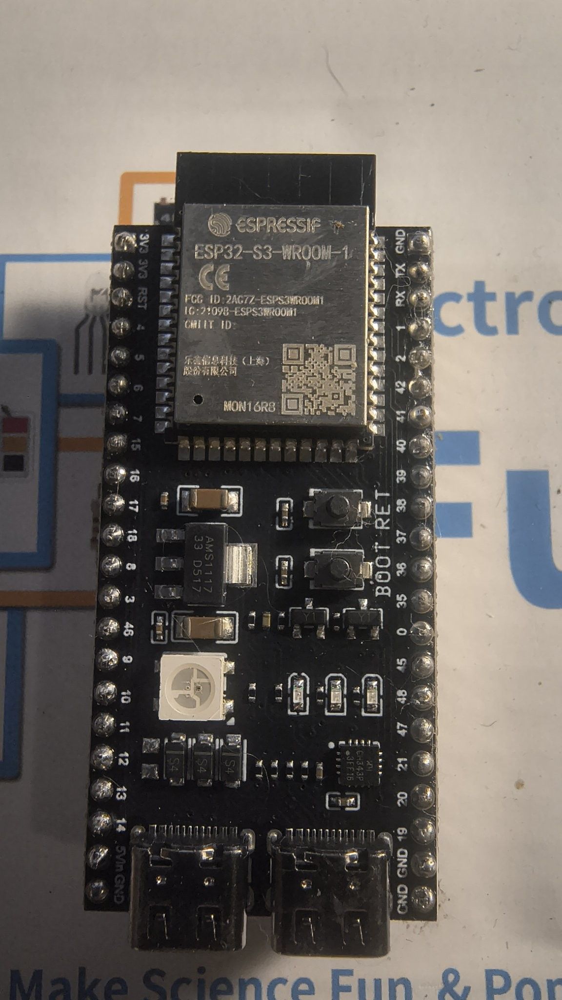

# MuseBridge: a Windows companion and local-tools harness for Muse

MuseBridge is a working Windows application that gives an existing Muse agent a
native presence on a Windows PC: a desktop chat window connected to the agent,
plus a local tool layer (files, shell, git, terminals, browser, desktop UI
automation, MCP servers, hooks) that executes on the PC under the owner's
control. The agent stays remote; there is no local model.

Current candidate: 0.8.0. Functional development build, in daily use by its owner.

## The problem it solves

Muse pairing is Bluetooth-only, and the official Muse Gadget SDK ships ESP32
and Linux targets only: there is no Windows SDK, and the reference development
PC has no Bluetooth adapter at all. Before MuseBridge, reaching the PC meant
stacking a cloud egress proxy, a VPN tunnel and SSH just to run one command
(seconds of overhead per action, before any real work).

## The workaround, as built

An ESP32-S3 board acts as a dumb Bluetooth front-end for provisioning, and
nothing more:

1. **Firmware** ([`firmware/serial-ble/`](firmware/serial-ble/)): a small,
   independent Arduino/NimBLE transport (about 115 lines). It advertises with
   the PC identity the host gives it and forwards raw ATT packets over its
   USB-UART socket as newline-delimited JSON with base64 payloads. It holds no
   token, no Wi-Fi credentials and no pairing cryptography.
2. **Host transport** (`musebridge/serial_ble.py`): a bounded serial transport
   (115200 baud, 4096-byte frames, per-boot epoch and per-connection generation
   guards, acknowledged sends for backpressure) that the **unmodified official
   SDK** pairing code talks to. All pairing cryptography stays in the official
   Python SDK, running natively on Windows.
3. **Provisioning only.** Once pairing completes, the board's job is done: the
   steady-state connection uses the PC's own network, and normal use needs no
   re-pair and no reflash. The full write-up is
   [docs/ESP32-BLE-FRONTEND.md](docs/ESP32-BLE-FRONTEND.md).

Hardware: a generic ESP32-S3-WROOM-1 (N16R8, 16 MB flash, 8 MB PSRAM) DevKit
style board with dual USB-C (a CH343 USB-UART socket, which is the one this
project uses, plus the S3 native USB socket), Bluetooth 5.0 LE and Wi-Fi.



## What the app does

- Native PySide6 chat window (Chat / Activity / Plan views) connected to the
  owner's Muse over the gadget transport; project-scoped conversations,
  a guarded request queue, continuity notes and chat handoffs.
- Local tools executed on the PC: file read/edit with change tracking, shell
  (PowerShell, cmd, Git Bash) with job handles, git status/diff/worktrees,
  ConPTY interactive terminals, headless-browser tools, guarded desktop UI
  automation (UIA first), PDF/DOCX text reading, Windows OCR fallback.
- Extensibility: local lifecycle hooks and MCP stdio servers with explicit
  per-tool grants. Desktop control sits behind an explicit profile and refuses
  to steal input while the owner is active.
- A floating companion widget: the agent's avatar on the desktop with a
  transparent quiet idle, hover controls and a compact quick-chat composer
  (see `musebridge/companion.py`).
- Pairing state and identity material are protected with Windows DPAPI. No
  telemetry, no public listener.

[RUNNING.md](RUNNING.md) documents day-to-day operation;
[MASTERPLAN.md](MASTERPLAN.md) is the architecture record;
[docs/DEVELOPMENT-NOTES.md](docs/DEVELOPMENT-NOTES.md) preserves the project's
own readme from development; the dated files under [evidence/](evidence/) are
the build's acceptance receipts, kept as written (sanitized, see below).

## Repository map

| Path | What it is |
|---|---|
| `musebridge/` | The application: UI, core worker, tools, pairing, transports |
| `tests/` | The test suite (600+ tests) |
| `tools/` | Probe and evaluation harnesses used during development |
| `tools/eval/` | The controlled evaluation suite (synthetic tasks and checker) |
| `firmware/serial-ble/` | The ESP32-S3 serial-BLE provisioning firmware |
| `docs/` | Design contracts, UI design, the agent skill for this PC |
| `evidence/` | Dated acceptance and measurement receipts |
| `vendor/PINNED.md` | The pinned upstream SDK revision (see below) |

## Setup

Prerequisites: Windows 11, Python 3.13+, [uv](https://docs.astral.sh/uv/),
and the upstream SDK checked out at the pinned revision:

```powershell
git clone https://github.com/facebookincubator/muse-gadget-sdk vendor/muse-gadget-sdk
git -C vendor/muse-gadget-sdk checkout 9d8cca156cdec9ea06efcf854b03dccc5ca76d42
uv sync
```

The SDK checkout is intentionally not vendored into this repository (it is a
large separate project with its own license, and one file in it is a signing
key). See [vendor/PINNED.md](vendor/PINNED.md).

For the ESP32 provisioning hardware, see
[`firmware/serial-ble/README.md`](firmware/serial-ble/README.md) for build and
flashing instructions, and the guide in
[docs/ESP32-BLE-FRONTEND.md](docs/ESP32-BLE-FRONTEND.md) for the pairing
session walkthrough.

Launch for development:

```powershell
pythonw -m musebridge.app --secondary-screen --connect
```

or install the current-user shortcuts with `Install-MuseBridge-Shortcuts.ps1`
and start with `Start-MuseBridge.ps1 -Connect`.

## Provenance and license

Original work in this repository is released under the MIT License (see
[LICENSE](LICENSE)). The Muse Gadget SDK is upstream work of its authors,
Apache License 2.0, and is **not** included here; MuseBridge depends on it as
a pinned external checkout. PlatformIO library dependencies of the firmware
(NimBLE-Arduino, ArduinoJson) are upstream projects under their own licenses,
fetched at build time.

This is an unofficial community project built on the public SDK. It is not
affiliated with or endorsed by Meta.

## Sanitization

This repository is a sanitized public copy of a private working tree. The
owner's name appears only in the LICENSE copyright line; personal identifiers,
account and device identifiers, local network details and private run data
were replaced with generic terms or removed, and the upstream SDK checkout
(which contains a signing key) was left out entirely. The classes of change
are recorded in [SANITIZATION-LOG.md](SANITIZATION-LOG.md).

An earlier revision of this repository published only the design documents,
before the source tree was prepared. The ESP32 guide in particular has been
rewritten from the shipped implementation; where the design and the build
differ, the build described here is what actually happened.
